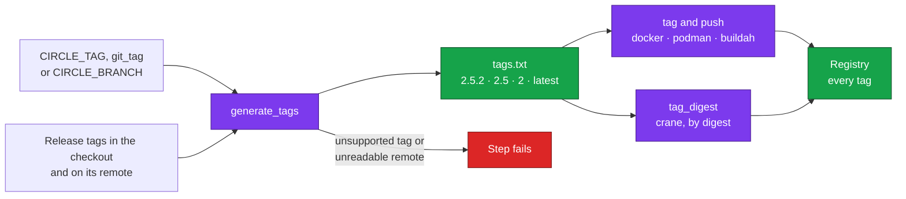

<div align="center">


# Container Tagger Orb for CircleCI

### Release `:2.5.2`, `:2.5`, `:2` and `:latest` from one git tag, and move each one only when it should.

Generate semantic-version container tags from your git tags, then tag and push them with Docker, Podman or Buildah,<br>
or retag a multi-platform image in its registry by digest. Three steps of CircleCI config.<br>
Floating tags never move backwards · Monorepo tag prefixes · Nothing to download, no `sudo`

[](https://circleci.com/gh/juburr/container-tagger-orb)
[](https://circleci.com/developer/orbs/orb/juburr/container-tagger-orb)
[](LICENSE)
[](https://discuss.circleci.com/c/ecosystem/orbs)


**[Quick Start](#-quick-start)** · **[Features](#-why-container-tagger-orb)** · **[Strategy](#-assumptions-and-strategy)** · **[Recipes](#-recipes)** · **[Multi-Platform](#-multi-platform-images)** · **[Commands](#-commands)** · **[Security](#-secure-by-design)**

<sub>A community-maintained orb. [Contributions are welcome!](#-contributing)</sub>

</div>

<br>

## ✨ Why container-tagger-orb?

When you release a new version of your software, you usually want several tags on the same container image, not just `:2.5.2`: `:latest` for the latest and greatest version, `:2.5` for the latest patch in the 2.5 series, and `:2` for the latest release in the 2 series. That isn't right for every release, though. If you later release an emergency security patch for the older 2.4 series, that image shouldn't get `:latest`, or even `:2`. It should get only `:2.4.8` and `:2.4`. Some projects also keep an `:edge` tag with the latest successful merges into the trunk that haven't received an official tag yet, so pre-release images can be pulled before the next release, for example into internal staging environments. This orb handles these edge cases and more.

<table>
<tr>
<td width="33%" valign="top">
🎯 <b>Floating tags that only move forward</b><br><br>
A final release gets <code>:X.Y</code>, <code>:X</code> and <code>:latest</code> only when it is the newest release in that series, so a patch to an older line never takes <code>:latest</code> from a newer one.
</td>
<td width="33%" valign="top">
🔎 <b>Sees every release, even in a shallow clone</b><br><br>
Release tag names come from the checkout and from its remote with <code>git ls-remote</code>, without downloading tagged commits. If the remote's list can't be read, the release fails instead of guessing.
</td>
<td width="33%" valign="top">
🧪 <b>Pre-releases and trunk builds handled</b><br><br>
<code>-rc</code>, <code>-alpha</code> and <code>-beta</code> releases get only their own tag. Merges into <code>main</code>, <code>master</code> or <code>develop</code> get <code>:edge</code> and <code>:&lt;branch&gt;-&lt;sha&gt;</code>; other branches get <code>:dev-&lt;sha&gt;</code>.
</td>
</tr>
<tr>
<td width="33%" valign="top">
🗂️ <b>Monorepo friendly</b><br><br>
Tags like <code>microservices/authservice/v1.0.5</code> work with <code>git_tag_prefix</code>. Only tags in that namespace are compared, and the container tags never include the prefix.
</td>
<td width="33%" valign="top">
🐙 <b>Multi-platform safe</b><br><br>
<code>tag_digest</code> applies every tag to an image index in its registry by digest, without pulling or pushing it, logs each tag's previous digest, and checks every tag afterwards. <a href="#-multi-platform-images">How it works</a>.
</td>
<td width="33%" valign="top">
🧰 <b>Your tools, your registry login</b><br><br>
Tag and push with <code>docker</code>, <code>podman</code> or <code>buildah</code>. The orb installs nothing and never handles registry credentials; it uses the login you already have.
</td>
</tr>
</table>

### 🧩 The Orb vs. a Hand-Rolled Script

| | Scripting it yourself | With the orb |
| --- | --- | --- |
| Deciding which tags a release gets | Parse the git tag, list existing tags, version-sort them, compare the major and minor series, skip pre-releases | `generate_tags` writes the list to a file |
| Seeing every existing release | `git fetch --tags`, downloading every tagged commit, or a shallow clone that silently misses older tags | Tag names from `git ls-remote`; an unreadable list fails the release |
| Monorepo namespaces | Filter tags by prefix without letting `svc/auth-legacy/v9.0.0` or `wip-v5.0.0` win | `git_tag_prefix` compares exactly `<prefix>/vX.Y.Z` |
| Retagging a multi-platform image | Avoid pull, retag and push, which flattens the index to one platform; script `crane tag` and check the result | `tag_digest` |

## 🔄 How It Works



`generate_tags` takes the release identity from `git_tag`, then `CIRCLE_TAG`, then `CIRCLE_BRANCH`. For a final release it compares the release with the existing release tags in the checkout and on its remote, and writes the container tags to a file, one per line. `tag` and `push` apply those tags to a local image and push them, or `tag_digest` applies them to an image already in the registry. `export_tag`, `export_image_ref` and `export_image_digest_ref` put the tag, `<image>:<tag>` and `<repository>@<digest>` in environment variables for later steps. For a `v2.5.2` release that is the newest overall, one image gets four tags:

<div align="center">
    
</div>

## 🚀 Quick Start

Build an image, generate its tags, and push every tag to GitHub Container Registry. Copy this into `.circleci/config.yml`:

```yaml
version: 2.1

orbs:
  tagger: juburr/container-tagger-orb@0.8.0

jobs:
  container_build:
    docker:
      - image: cimg/base:current-22.04
    steps:
      - checkout
      - setup_remote_docker
      - run:
          name: Build Docker Container
          command: docker build -t localimage .
      - tagger/generate_tags
      - tagger/tag:
          source_image: localimage
          target_image: ghcr.io/org/repo/image
      - run:
          name: Authenticate with GHCR
          command: printf '%s\n' "${GITHUB_TOKEN}" | docker login ghcr.io -u "${GITHUB_USER}" --password-stdin
      - tagger/push:
          target_image: ghcr.io/org/repo/image
      - run:
          name: Logout from GHCR
          command: docker logout ghcr.io

workflows:
  build:
    jobs:
      - container_build:
          context:
            - yourproject-github-pkg-rw
          filters:
            tags:
              only: /^v(?!0\d)[0-9]+(\.(?!0\d)[0-9]+){2}(\-(alpha|beta|rc)([0-9]+|\.[0-9]+)?)?$/
```

Change `target_image`, and put `GITHUB_USER` and a `GITHUB_TOKEN` that can write packages in the context. The workflow runs on every branch and on release tags. A `v2.5.2` tag pushes `:2.5.2`, plus `:2.5`, `:2` and `:latest` when they apply; a merge into `main` pushes `:edge` and `:main-<sha>`; any other branch pushes `:dev-<sha>`. The job log lists the tags `generate_tags` chose and why.

> [!NOTE]
> A tag pipeline whose git tag isn't a [supported release tag](#-assumptions-and-strategy) fails, rather than publishing that release as `:dev-<sha>` or `:edge`. The `filters` regex above matches only the supported forms, so other git tags don't start the job at all.

> [!TIP]
> Upgrading from 0.7.4 or earlier? Several commands and parameters were renamed. See [Upgrading](#-upgrading).

## 🧭 Assumptions and Strategy

This orb requires that your git tags follow semantic versioning. Examples of valid tags include:
- `v2.5.2`
- `v2.5.3-rc1`
- `v2.5.3-rc`
- `v2.5.3-rc.1`
- `v2.5.3-alpha1`
- `v2.5.3-beta4`

`alpha` and `beta` accept the same suffix shapes as `rc`. A tag pipeline whose git tag is not one of these forms fails, instead of publishing that release as `dev-<sha>` or `edge`. The same forms apply to the `git_tag` parameter described below.

This orb functions by reading git tags to determine which versions already exist. A final release compares the tag being built with tags in the checkout and with tag names from the checkout's remote. `git ls-remote` supplies those names without downloading tagged commits. `origin` is used when it exists; otherwise the sole remote is used. Several remotes and no `origin` is a failure, so the orb does not guess which remote is authoritative. A shallow checkout whose local `git tag` output contains only the current tag still sees older tags on the remote. If that remote list cannot be read, the release fails, so an older tag cannot take the newest floating tags. A checkout with no remote uses local tags, and an empty list is a first release that still publishes the floating tags. Pre-releases leave floating tags unchanged and skip this check.

Credentials in the remote URL stay off the command line. An HTTP or HTTPS remote URL that embeds credentials is read without putting those credentials on the git transport command line; the scheme is matched case-insensitively. A password embedded in any other kind of remote URL, such as `ftp://` or `ssh://`, fails the release, because it cannot be kept off that transport's command line. An `@` in the repository path stays part of the path. A URL that contains only a username still uses configured credential helpers for its password, and falls back to an empty password, as git does for `https://TOKEN@host`. That read uses the URL without its userinfo, so `http.<url>.*` settings scoped to a username (`http.https://alice@host.sslCAInfo`) do not apply to it; scope them to the host instead. An `insteadOf` rule that injects credentials and whose value is the remote's entire URL, such as `url."https://TOKEN@host/repo.git".insteadOf "https://host/repo.git"`, fails the release, because the orb cannot override it without the credentials reaching the transport; use a host-level rule (`insteadOf "https://host/"`) instead.

Any merge into `master`, `main`, or `develop` will result in an `:edge` tag being created, along with `:<branch>-<sha>` (the first eight characters of the commit SHA), provided your container build job is within a workflow that builds on non-tagged commits. Commits to any other branch get `:dev-<sha>`.

Running a Golang monorepo where you're creating tags such as `microservices/authservice/v1.0.5`? No problem. This is supported as well. Pass the git tag namespace as `git_tag_prefix: microservices/authservice` to `generate_tags` and `export_tag`. The prefix only selects git tags; the container tags never include it. `microservices/authservice/v1.0.5` produces `:1.0.5`, plus `:1.0`, `:1`, and `:latest` when it is the newest release in that namespace.

Only tags in the same namespace are compared when choosing `:latest`, `:X`, and `:X.Y`. With `git_tag_prefix: microservices/authservice`, that is exactly `microservices/authservice/vX.Y.Z`; tags such as `microservices/authservice-legacy/v9.0.0` or `microservices/authservice/beta/v9.0.0` are ignored. Without a `git_tag_prefix`, it is `vX.Y.Z` with no slash, so tags such as `zeta/v9.9.9`, `wip-v5.0.0`, or `opengee-v5.3.9` are ignored.

### Releasing Without a Tag Pipeline: `git_tag`

By default the release identity is `CIRCLE_TAG`, and when that is empty, `CIRCLE_BRANCH` selects `:edge` or a `dev-<sha>` tag. Some release workflows do not run from a tag pipeline, for example a protected `release-execution/<tag>` branch that carries its own validated release tag. Pass that tag to both `generate_tags` and `export_tag` as `git_tag`:

```yaml
- tagger/export_tag:
    git_tag: ${RELEASE_TAG}
- tagger/generate_tags:
    git_tag: ${RELEASE_TAG}
```

When `git_tag` is set:
- It is the only release identity. `CIRCLE_BRANCH` is not consulted, so a release whose pipeline runs on `main` does not also publish `:edge` or `main-<sha>`.
- It must be a supported release tag, using the same forms listed above. Anything else fails the step. There is no fallback to `CIRCLE_TAG`, `:edge`, `main-<sha>`, or `dev-<sha>`.
- If `CIRCLE_TAG` is also set, the two must be identical.
- With a `git_tag_prefix`, it must be the full tag name, `<git_tag_prefix>/vX.Y.Z`. A bare `vX.Y.Z` or another prefix fails, because those are different git tags. (`CIRCLE_TAG` still also accepts a bare `vX.Y.Z` with a `git_tag_prefix`, for compatibility.)
- A value that expands to an empty string, such as `${RELEASE_TAG}` when that variable is unset, fails the step instead of falling back. To keep the default behaviour, leave the parameter empty, for example with a pipeline parameter that defaults to `""`.
- A final release still compares against the repository's existing tags, from the checkout and its remote, to choose `:latest`, `:X`, and `:X.Y`, so a branch checkout that lacks some release tags does not need `git fetch --tags` first.

Both commands log which identity they used: `git_tag`, `CIRCLE_TAG`, or the branch.

## 🍳 Recipes

### Use the Tag and Image Reference in Later Steps

`export_tag` writes the most specific tag to `TAG`, `export_image_ref` turns it into `IMAGE_REF`, and after the image is pushed, `export_image_digest_ref` reads its digest into `IMAGE_DIGEST_REF`, ready for signing or for `tag_digest`:

```yaml
- tagger/export_tag                # TAG=1.2.3
- tagger/export_image_ref:
    image: ghcr.io/org/app         # IMAGE_REF=ghcr.io/org/app:1.2.3
# ...build and push ${IMAGE_REF}...
- tagger/export_image_digest_ref   # IMAGE_DIGEST_REF=ghcr.io/org/app@sha256:...
```

The values are shell-quoted in `BASH_ENV`, so they reach every later step in the same job. Each `*_env_var` parameter changes a variable's name.

### Monorepo Releases

Give each service its own tag namespace, such as `microservices/authservice/v1.0.5`, and pass the namespace to `generate_tags` (and `export_tag`, if you use it). Only that namespace's releases decide its floating tags:

```yaml
- tagger/generate_tags:
    git_tag_prefix: microservices/authservice
- tagger/tag:
    source_image: authservice
    target_image: ghcr.io/org/authservice
    push: true
```

Filter the workflow on that namespace's tags, for example `only: /^microservices\/authservice\/v.*/`. `push: true` makes `tag` push every tag once they're all applied, so a separate `push` step isn't needed.

### Tag With Podman

Set `tool` on `tag` and `push` to use `podman` instead of `docker`, for builds that don't use a Docker daemon:

```yaml
- tagger/tag:
    source_image: localhost/myapp
    target_image: ghcr.io/org/app
    tool: podman
- tagger/push:
    target_image: ghcr.io/org/app
    tool: podman
```

## 🐙 Multi-Platform Images

The `tag` and `push` commands work through a local container tool (`docker`, `podman`, or `buildah`), which holds one platform of an image. Pulling a multi-platform image, tagging it, and pushing it again replaces its index with a single-platform manifest.

For an image that is already in a registry, use `tag_digest`. It applies every tag in the tags file to `repository@sha256:<digest>` in place, with `crane tag`, and never pulls or pushes image content. Every tag ends up on the same index digest, with every platform.

```yaml
version: 2.1

orbs:
  tagger: juburr/container-tagger-orb@0.8.0

jobs:
  promote:
    docker:
      - image: cimg/base:current-22.04
    steps:
      - checkout
      - run:
          name: Install crane
          command: |
            # Pin the version and verify the archive's checksum in practice.
            curl -fsSL -o crane.tar.gz https://github.com/google/go-containerregistry/releases/download/v0.22.1/go-containerregistry_Linux_x86_64.tar.gz
            tar -xzf crane.tar.gz crane
            sudo install -m 0755 crane /usr/local/bin/crane
      - run:
          name: Authenticate with GHCR
          command: echo $GITHUB_TOKEN | crane auth login ghcr.io -u $GITHUB_USER --password-stdin
      - tagger/generate_tags:
          tags_file: tags.txt
      - tagger/tag_digest:
          # The index digest your build pushed, for example from docker buildx --metadata-file.
          image_digest_ref: ghcr.io/org/repo/image@${BUILD_DIGEST}
          tags_file: tags.txt

workflows:
  release:
    jobs:
      - promote:
          context:
            - yourproject-github-pkg-rw
```

How it behaves:
- `crane` must be on `PATH`; this orb does not install it. Registry credentials come from the Docker config, so `docker login` (or `crane auth login`) works.
- `image_digest_ref` must be `repository@sha256:<64 hex characters>`, and the tags are written to that same repository. `export_image_digest_ref` can produce it as `${IMAGE_DIGEST_REF}`. To promote into another repository, copy by digest first, for example `crane copy src@sha256:... dst@sha256:...`.
- Before writing, each tag's current digest is logged as `<tag> <sha256:...>` or `<tag> absent`.
- `expected_digests_file` takes that same format, one line per tag in the tags file. If any tag no longer matches, no tag is written. Use it to make sure the tags you planned to move have not moved since. The check runs just before writing and is not atomic; registries have no conditional tag write.
- A tag that already points at the digest is not rewritten.
- After writing, every tag must resolve to the source digest, or the step fails.
- If a write fails partway, the log lists the tags that were already written, and their previous digests are logged above it.

## 🧰 Commands

Relative paths are resolved against the working directory, and a leading `~/` in a path means `$HOME`.

### `tagger/generate_tags`

Writes the container tags for this build to a file, one per line, reading the release identity from `git_tag`, `CIRCLE_TAG` or `CIRCLE_BRANCH` as described in [Assumptions and Strategy](#-assumptions-and-strategy). A final release `vX.Y.Z` gets `X.Y.Z`, plus `X.Y`, `X` and `latest` when it is the newest release in that series; a pre-release gets only its own tag, such as `2.5.3-rc1`. A final release reads the existing tags of the git checkout it runs in, and of that checkout's remote.

| Parameter | Default | Description |
| --- | --- | --- |
| `tags_file` | `tags.txt` | File to write the tags to. It is created or truncated. |
| `git_tag_prefix` | *(empty)* | Git tag namespace for monorepos, without a trailing slash: `svc/auth` matches git tags like `svc/auth/v1.2.3`, and only tags in that namespace are compared. The container tags never include it. |
| `git_tag` | *(empty)* | Git tag of the release, used instead of `CIRCLE_TAG`, such as `${RELEASE_TAG}`. See [Releasing without a tag pipeline](#releasing-without-a-tag-pipeline-git_tag). |

### `tagger/tag`

Applies every tag in the tags file to `target_image` with a local container tool, pulling `source_image` first when it is not local. Handles one platform; see [Multi-Platform Images](#-multi-platform-images).

| Parameter | Default | Description |
| --- | --- | --- |
| `source_image` | *required* | Local or pullable image to tag. |
| `target_image` | *required* | Repository to tag, without a tag, e.g. `ghcr.io/org/app`. Each tag is applied as `<target_image>:<tag>`. |
| `tags_file` | `tags.txt` | File with the tags, one per line, as written by `generate_tags`. |
| `tool` | `docker` | `docker`, `podman`, or `buildah`. |
| `append_tags_to_source` | `false` | Use `source_image:<tag>` as the source of each tag, instead of `source_image`. |
| `push` | `false` | Push each tag after tagging, as `push` does. |

### `tagger/push`

Pushes `target_image:<tag>` for every tag in the tags file, from the local container tool. Log in to the registry first. Handles one platform; see [Multi-Platform Images](#-multi-platform-images).

| Parameter | Default | Description |
| --- | --- | --- |
| `target_image` | *required* | Repository to push, without a tag, e.g. `ghcr.io/org/app`. |
| `tags_file` | `tags.txt` | File with the tags, one per line, as written by `generate_tags`. |
| `tool` | `docker` | `docker`, `podman`, or `buildah`. |

### `tagger/tag_digest`

Applies every tag in the tags file to an image that is already in a registry, without pulling or pushing it. Needs `crane` on `PATH` and registry credentials, for example from `docker login`. See [Multi-Platform Images](#-multi-platform-images).

| Parameter | Default | Description |
| --- | --- | --- |
| `image_digest_ref` | *required* | Image digest reference, `repository@sha256:<64 hex characters>`, such as `${IMAGE_DIGEST_REF}` from `export_image_digest_ref`. A tag is not accepted. The tags are written to this repository. |
| `tags_file` | `tags.txt` | File with the tags, one per line. Each must be a valid tag and appear only once. |
| `expected_digests_file` | *(empty)* | Optional file of `<tag> <sha256:digest>` or `<tag> absent` lines, one for every tag in `tags_file`; any mismatch stops every write. |

### `tagger/export_tag`

Exports the most specific container tag for this build, chosen with the same rules as `generate_tags`, to an environment variable for later steps: `1.2.3` (or `1.2.3-rc1`) for a release, `<branch>-<sha>` on `main`, `master` or `develop`, `dev-<sha>` elsewhere. The value is shell-quoted in `BASH_ENV`.

| Parameter | Default | Description |
| --- | --- | --- |
| `tag_env_var` | `TAG` | Output: *name* of the variable to write the tag to. `export_image_ref` reads it. |
| `git_tag_prefix` | *(empty)* | Same as in `generate_tags`. |
| `git_tag` | *(empty)* | Same as in `generate_tags`. |

### `tagger/export_image_ref`

Exports `<image>:<tag>` to an environment variable for later steps, with the tag read from the variable `export_tag` wrote, so run `export_tag` first. The value is shell-quoted in `BASH_ENV`.

| Parameter | Default | Description |
| --- | --- | --- |
| `image` | *required* | Repository without a tag, e.g. `ghcr.io/org/app`. |
| `tag_env_var` | `TAG` | Input: *name* of the variable that already holds the tag, as written by `export_tag`. |
| `image_ref_env_var` | `IMAGE_REF` | Output: *name* of the variable to write the image reference `<image>:<tag>` to. |

### `tagger/export_image_digest_ref`

Exports the image digest reference, `<repository>@<digest>`, of the image reference `export_image_ref` wrote, for later steps or for `tag_digest`. It reads the digest with `crane digest` when crane is on `PATH`, and otherwise from docker's `RepoDigests`, pulling the image if it is not local. The image must already be in the registry. The step fails if no digest can be read. A registry port stays part of the name.

| Parameter | Default | Description |
| --- | --- | --- |
| `image_ref_env_var` | `IMAGE_REF` | Input: *name* of the variable that already holds the image reference, as written by `export_image_ref`. |
| `image_digest_ref_env_var` | `IMAGE_DIGEST_REF` | Output: *name* of the variable to write the image digest reference `<repository>@<digest>` to. |

Environment variables are expanded in `tags_file`, `git_tag_prefix`, `git_tag`, `image`, `source_image`, `target_image`, `image_digest_ref` and `expected_digests_file`.

## 📦 Upgrading

Releases after 0.7.4 rename these commands and parameters. `source_tag` and `tag_digest` were added after 0.7.4, so their old names only matter if you tested a development version.

| Old | New |
| --- | --- |
| `populate_tag` | `export_tag` |
| `populate_image_uri` | `export_image_ref` |
| `populate_image_uri_digest` | `export_image_digest_ref` |
| `generate_tags.outfile` | `tags_file` |
| `package` (`generate_tags`, `populate_tag`) | `git_tag_prefix` |
| `source_tag` (`generate_tags`, `populate_tag`) | `git_tag` |
| `image_uri_env_var` (default `IMAGE_URI`) | `image_ref_env_var` (default `IMAGE_REF`) |
| `image_digest_env_var` (default `IMAGE_URI_DIGEST`) | `image_digest_ref_env_var` (default `IMAGE_DIGEST_REF`) |
| `tag_digest.image_digest` | `image_digest_ref` |

Behavior changes:
- The default exported variables are now `IMAGE_REF` and `IMAGE_DIGEST_REF`. Steps that read `${IMAGE_URI}` or `${IMAGE_URI_DIGEST}` must use the new names, or set `image_ref_env_var: IMAGE_URI` and `image_digest_ref_env_var: IMAGE_URI_DIGEST`.
- A leading `~/` in `tags_file` and `expected_digests_file` now means `$HOME`. It used to be taken literally, as a path under a directory named `~` in the working directory.
- `export_tag` and `export_image_ref` write shell-quoted values to `BASH_ENV`, as `export_image_digest_ref` already did.
- Error messages start with `ERROR:` instead of `Error:` (or no prefix), and go to stderr. A step that searches a command's output for an error must read stderr too.

## 🔒 Secure by Design

- **Least Privilege**: No `sudo` anywhere in this orb, and nothing to install: the commands use the `git`, `docker`, `podman`, `buildah` or `crane` already on your executor.
- **Integrity**: The orb fails rather than guess. An unsupported release tag, a `git_tag` that expands to nothing, an unreadable remote tag list or several remotes without `origin` all fail the step, so a release can't take floating tags it shouldn't. `tag_digest` only tags a digest the registry confirms, can refuse to write when tags moved since you planned (`expected_digests_file`), and checks every tag afterwards.
- **Provenance**: The orb downloads nothing. Tags come from your repository's git tags, and images from your own build or registry.
- **Confidentiality**: The orb never takes registry credentials; `push` and `tag_digest` use the login already in your Docker config. Credentials embedded in an HTTP or HTTPS remote URL are kept off the git command line, redacted from the error output `generate_tags` prints, and held in a private `mktemp` directory that is removed when the step exits; shell tracing is off while it runs. Exported values are shell-quoted with `printf %q`, so no value can break or inject into later steps.
- **Privacy**: No usage data of any kind is collected or shipped back to the orb developer.

> [!IMPORTANT]
> **Info for security teams:** see [Network Access](#-network-access) for the hosts to allow on locked-down or self-hosted runners.

## 💻 Supported Platforms

Linux executors on any architecture, since the orb runs no binaries of its own; CI runs it on `cimg/base` (amd64). Each command runs in bash and needs the tools it calls on `PATH`:

| Command | Needs |
| --- | --- |
| `generate_tags` | A git checkout, `git`, and GNU coreutils (`realpath`, `truncate`, `sort --version-sort`), as on `cimg/base` |
| `tag`, `push` | `docker`, `podman` or `buildah` (`tool`). With Docker on a Docker executor, run `setup_remote_docker` first. |
| `tag_digest` | `crane` |
| `export_image_digest_ref` | `crane`, or `docker` |
| `export_tag`, `export_image_ref` | Nothing beyond bash |

## 🌐 Network Access

Hosts to allow when running on a locked-down or self-hosted runner. The orb downloads nothing itself; these are the connections its commands make through `git`, your container tool and `crane`.

| Host | Needed by | Purpose |
| --- | --- | --- |
| Your checkout's git remote, e.g. `github.com` (HTTPS on port 443, or SSH on port 22 for a `git@` remote) | `generate_tags`, for a final release | `git ls-remote` reads the remote's tag names, to choose `:latest`, `:X` and `:X.Y` |
| The registry of `source_image`, plus the authentication and storage hosts it redirects to | `tag`, when `source_image` isn't local | Pulling the image to tag |
| The registry of `target_image`, likewise | `push`, and `tag` with `push: true` | Pushing each tag |
| The registry in `image_digest_ref`, likewise | `tag_digest` | Reading digests and writing tags with `crane` |
| The registry of the image in `IMAGE_REF`, likewise | `export_image_digest_ref` | Reading the digest with `crane`, or pulling the image with `docker` when it isn't local |

`generate_tags` for a pre-release or a branch build, `export_tag` and `export_image_ref` make no network connections.

## 🤝 Contributing

This is a community-maintained orb, and contributions are welcome! Bug reports, feature ideas and pull requests all help.

- **Found a bug or have an idea?** [Open an issue](https://github.com/juburr/container-tagger-orb/issues).
- **Before opening a pull request**, run the checks CI runs. Most tests run offline with stand-ins for `git` remotes, `crane`, `docker` and `circleci`; `test/tag_digest_registry_test.sh` needs `crane`, `jq`, a `registry:2` on `localhost:5000` and network access to `gcr.io`, as CI provides.

  ```bash
  yamllint .
  shellcheck src/scripts/*.sh test/*.sh
  for t in test/*_test.sh; do bash "$t" || break; done
  circleci orb pack src > orb.yml && circleci orb validate orb.yml
  ```

## 🎨 Logo

Need the logo for a slide deck, blog post, or internal developer portal? PNGs with transparent backgrounds are in [`assets/logos`](assets/logos): [64](assets/logos/container-tagger-orb-64px.png) · [128](assets/logos/container-tagger-orb-128px.png) · [256](assets/logos/container-tagger-orb-256px.png) · [512](assets/logos/container-tagger-orb-512px.png) · [1024](assets/logos/container-tagger-orb-1024px.png) px

## 📜 License

[MIT](LICENSE) © 2024-2025 Justin Burr

<br>

<div align="center">
  
  <br>
  <sub>One git tag in, every container tag out. If this orb helps your team, a ⭐ helps others find it.</sub>
  <br>
  <sub><a href="#container-tagger-orb-for-circleci">Back to top ↑</a></sub>
</div>
